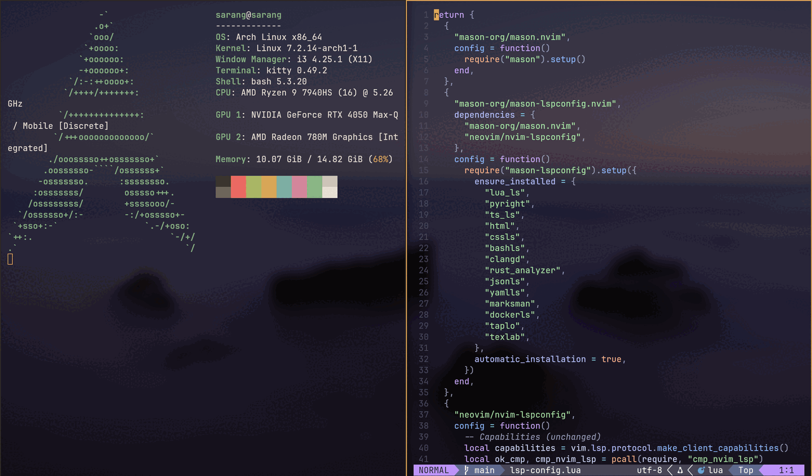
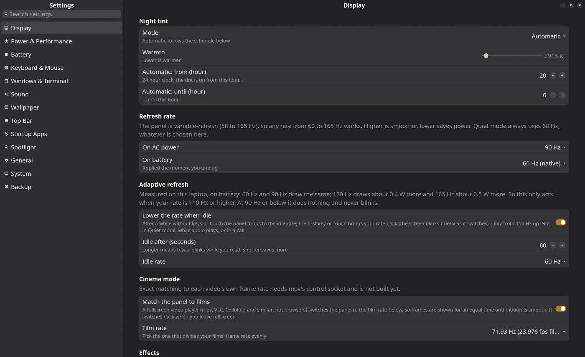

# i3-dotfiles

My desktop, lovingly over-engineered. This is the i3 setup I live in on an **ASUS ROG Flow X13** (Ryzen 9 7940HS, RTX 4050, Arch Linux, X11): warm amber and chalk colours, vim-style keys, and not a single notification. If something on my screen makes a noise, it's because I asked it to.

It started as "I'll just tidy the config a bit" and then I kept going. You have been warned.

## What it looks like

*Tiled kitty and Neovim on the amber-and-dusk look, with the bar along the bottom (cropped out here, because it knows my Wi-Fi name).*

| My Settings app | My Spotlight |
|---|---|
|  |  |
| One window for display, power, input, sound, wallpaper, the bar and backups. It writes `rog/settings.env`, so I never have to. | Apps, open windows and files in one box. It opens in about 20 ms. |

## What's in here
| Folder | What it is |
|---|---|
| `i3`, `polybar`, `picom`, `kitty`, `rofi`, `mpv`, `btop`, `yazi`, ... | the desktop itself: window manager, bar, compositor, terminal and friends |
| `scripts/` | the glue that holds my days together: my own **Spotlight** (apps, files, maths, clipboard history and actions in one search box), a GTK4/libadwaita **Settings** app, power modes, adaptive refresh rate, night tint, screen rotation, backups to my home server, and `rog-update.sh`, which makes me read the Arch news before it lets me update (and can roll back when I regret it) |
| `apps/spotlight/` | a copy of my standalone Spotlight repo (launcher, power menu, installer). The live copies sit in `scripts/` |
| `i3lock/lock.sh` | my lock screen: blurred wallpaper, plus a big thin clock and a round ring with my name on it if `i3lock-color` is installed (plain `i3lock` if not) |
| `rog-tune/` | the root-side tuning. `rog-tune.sh` is a dry run unless I say `--apply` (and `--undo` exists for moments of doubt); `rog-lean-session.sh` is the user-level installer. Highlights: the **greetd + ReGreet** login screen (warm theme, rotates with the accelerometer), a restore point before every pacman transaction, power saving on battery, kernel and GRUB options |
| `iso/` | the recipe for my restore ISO: a bootable Arch installer that rebuilds this laptop offline, with `rog-restore` as the installer. The ISO itself is too big for GitHub; see `iso/README.md` |
| `rog/settings.env` | every setting my scripts read. The Settings app writes it, so I rarely touch it by hand |

## Installing it (on a laptop that isn't mine: good luck and godspeed)
```
./install.sh                          # copies my user config, backing up whatever it replaces
sudo ./rog-tune/rog-tune.sh           # dry run: shows every root change as a diff
sudo ./rog-tune/rog-tune.sh --apply greetd speed tidy   # an example
```
What I install first (Arch): `i3-wm polybar picom kitty rofi python-gobject gtk4 libadwaita libqalculate plocate ripgrep xss-lock xclip imagemagick`. Optional extras: `i3lock-color` (AUR) for the pretty lock screen, and `greetd greetd-regreet sway` for the login screen.

## Fair warning
The monitor name, touchpad id, PCI addresses and GRUB entries in `rog-tune.sh` are all for *my* laptop. Please read the dry run before applying anything; I'd hate to be the reason your boot breaks.

My Neovim config lives in its own repo.
