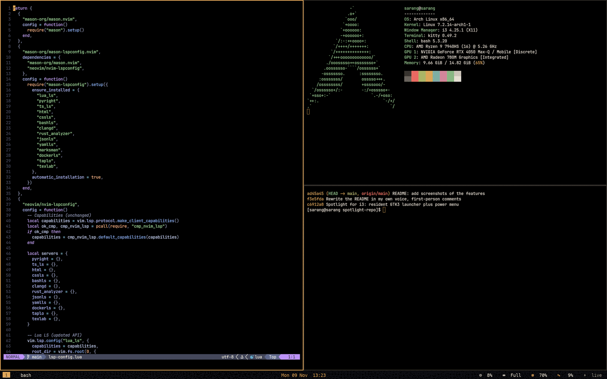

# My i3 desktop

This is the desktop I live in on an **ASUS ROG Flow X13** (Ryzen 9 7940HS, RTX 4050, Arch Linux, X11): the i3 window manager, a bottom polybar, picom for translucency, kitty, my own Spotlight and Settings apps, and a pile of small scripts that make the laptop behave (power modes, refresh rate, rotation, lock screen).
Everything is in one repository: [`sarang-kernel/i3-dotfiles`](https://github.com/sarang-kernel/i3-dotfiles).



## How the pieces fit together

```text
 login (greetd + ReGreet)              rog-tune/  (root side, dry-run by default)
        |                                    |
        v                                    v
   startx -> i3  --exec-->  picom, polybar, wallpaper, power-watch.sh, display-agent.py,
        |                    nightlight.sh daemon, autorotate.sh, autocaffeine.sh,
        |                    rog-ui.sh start  ->  resident Spotlight process
        |
        +-- keys (Super+D, Super+comma ...) -> Spotlight / Settings / scripts
        +-- ~/.config/rog/settings.env  <-- written by the Settings app, read by every script
```

- **i3** is the window manager; the config is a standard i3 v4 file with my additions, each tagged `# rog-tune:` so I can find them.
- **`settings.env`** is the glue. The Settings app writes it; scripts *source* it. No daemon keeps state in memory.
- **Spotlight and Settings** are my own GTK programs. Spotlight is a resident process (so it opens instantly), Settings starts on demand.
- **rog-tune** is how all of this got installed and how the root-side parts are applied. Everything has a dry run and an undo.

## What's in this section

| Page | What you get |
|---|---|
| [Install and layout](install.html) | Packages, `install.sh`, what each folder of the repo is |
| [Keybindings](keybindings.html) | Every binding, generated from the config |
| [Windows, workspaces and rules](windows.html) | Window rules, borders, colours, layout cheat-sheet |
| [Autostart and session](autostart.html) | Everything i3 starts, and why |
| [Polybar](polybar.html) | The bar: modules, clicks, helper scripts |
| [Compositor (picom)](compositor.html) | Translucency, blur, the AC/battery variants |
| [Terminal (kitty)](terminal.html) | Font, opacity, vim-style scrollback |
| [Lock screen](lock-screen.html) | The i3lock-color lock screen and the idle timer |
| [Colours, accent and fonts](theme.html) | The warm palette and how the accent colour is applied |
| [Other app configs](other-apps.html) | btop, mpv, cava, dunst, touchegg, yazi, rofi, GTK ... |
| [How the screenshots are made](screenshots.html) | The virtual-screen trick behind the README pictures |
| [Troubleshooting](troubleshooting.html) | Things that went wrong and what fixed them |
