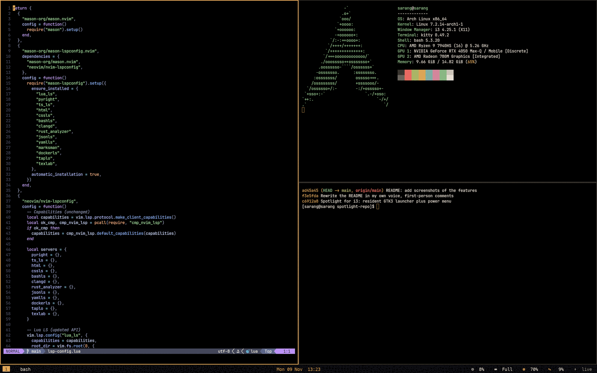

# My Linux setup, documented

Hi. These are the docs for the things I built and tuned on my two Arch Linux laptops, written so that future-me (and anyone curious) can find out **what exists, how it works, how to change it and how to put it back**.
It is a *personal* setup, so read before you run: nothing here is a product, but everything has a dry run, an undo or a backup where it matters.

## The machines

| Machine | What it is | Software |
|---|---|---|
| **ASUS ROG Flow X13** (Ryzen 9 7940HS, RTX 4050, 2560×1600 165 Hz) | My main PC | Arch Linux, **X11 + i3**, polybar, picom, my own Spotlight and Settings apps |
| **HP EliteBook 840 G1** (Core i5-4300U) | The **home server** and a normal laptop | Arch Linux, **Hyprland** (Lua config), Quickshell shell, hp-dash |

## Sections

| Section | What is in it |
|---|---|
| [i3 desktop](i3/) | Keybindings, windows and rules, autostart, polybar, compositor, terminal, lock screen, colours, other app configs, troubleshooting |
| [Spotlight](spotlight/) | My Spotlight-style launcher: every kind of query, every key, clipboard history, timers, deep search, internals |
| [Scripts](scripts/) | Every helper script explained (power, display, session, system), the Settings app, the 39 settings, dependencies, conventions |
| [rog-tune](rog-tune/) | The tuning installers: all root-side and user-side *parts*, the helper tools, backups and undo |
| [Restore ISO](iso/) | A bootable Arch image that rebuilds the laptop offline: how it is built, restored, tested and secured |
| [Neovim](nvim/) | The editor config: keymaps, plugins, language servers, Markdown, LaTeX, known issues |
| [HP desktop and server](hp/) | Hyprland setup, theming, swappable shell, the home server, hp-dash, boot tuning |
| [Reference](reference/) | The file index and other generated lists |
| [What I changed and why](changes/) | A dated log of the changes and the reasoning |

## How these docs are made (and why you can trust them)

I do not write reference tables by hand. A small generator reads the **real files** and writes the tables: the i3 keybindings come from `i3/config`, the Hyprland binds from `binds.lua`, the Neovim keymaps from the Lua files, the 39 settings from `settings.py`, the rog-tune *parts* from the headers of the scripts, the dependencies by scanning every script. The prose around them was written after reading the code, and where the code disagrees with a README or a comment I say so (see [Neovim known issues](nvim/troubleshooting.html)).
The generator also checks that every file in the repositories appears in the [file index](reference/file-index.html), and that every internal link resolves.

## How to read a page

- `Super` is the Windows key (on my keyboards it is also Caps Lock).
- A path starting with `~/.config/…` is on the machine; a path like `scripts/…` is in the `i3-dotfiles` repository.
- A code block is something you can paste. A *Known issue* is something I found while documenting and did not silently fix.

## The repositories

- [`sarang-kernel/i3-dotfiles`](https://github.com/sarang-kernel/i3-dotfiles): the i3 desktop, the scripts, rog-tune, the ISO recipe, and these docs (`docs/`).
- [`sarang-kernel/spotlight`](https://github.com/sarang-kernel/spotlight): Spotlight on its own.
- [`sarang-kernel/nvim`](https://github.com/sarang-kernel/nvim): the Neovim config.
- The HP's configuration is on the machine itself (`~/.config/hypr`, `~/.local/share/hp-dash`) and documented in the HP section.
