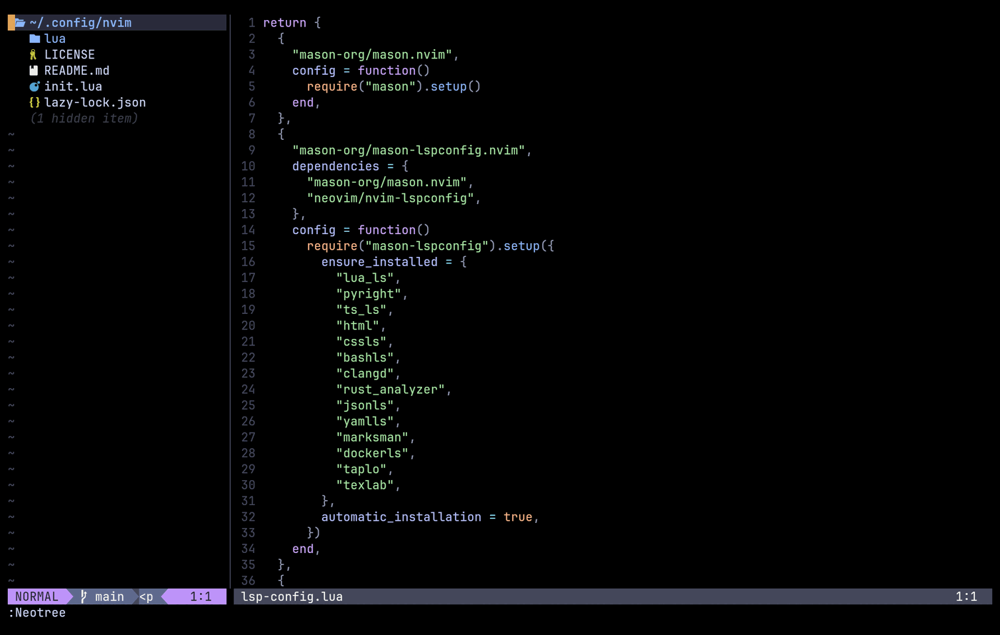

# Neovim

My Neovim setup: **lazy.nvim**, 30 plugins, the Catppuccin Mocha theme with a transparent background, LSP for 14 languages through Mason, format-on-save, Telescope, Neo-tree, a debugger, an excellent Markdown renderer and a LaTeX workflow.
It lives in its own repo: [`sarang-kernel/nvim`](https://github.com/sarang-kernel/nvim) (MIT licence), and is included in my dotfiles as a git submodule.



## Pages

| Page | What you get |
|---|---|
| [Install and layout](install.html) | Requirements, first start, what each file is |
| [Keymaps](keymaps.html) | Every keymap I define, generated from the Lua files |
| [Plugins](plugins.html) | All 30 plugins with the pinned commit, and what I use each for |
| [Language servers, formatting and diagnostics](lsp-format.html) | Mason, the servers, none-ls, format on save |
| [Markdown](markdown.html) | render-markdown and my `[[wiki link]]` navigation |
| [LaTeX](latex.html) | VimTeX with latexmk and zathura, and the snippets |
| [LaTeX snippets](snippets.html) | Every snippet trigger |
| [Git and debugging](git-debug.html) | gitsigns and nvim-dap |
| [Customising](customising.html) | How to change things safely |
| [Troubleshooting and known issues](troubleshooting.html) | Including two things that are documented but not wired up |

## The shape of it

```text
~/.config/nvim/
  init.lua              bootstraps lazy.nvim, loads vim-options, calls lazy.setup("plugins"), loads alpha
  lua/vim-options.lua   options, leader keys, general keymaps, and helper functions other files call
  lua/plugins/*.lua     one lazy.nvim spec per file (16 files)
  lua/utils/snippets.lua   my LaTeX snippets
  lazy-lock.json        the pinned plugin commits
  README.md  LICENSE
```
