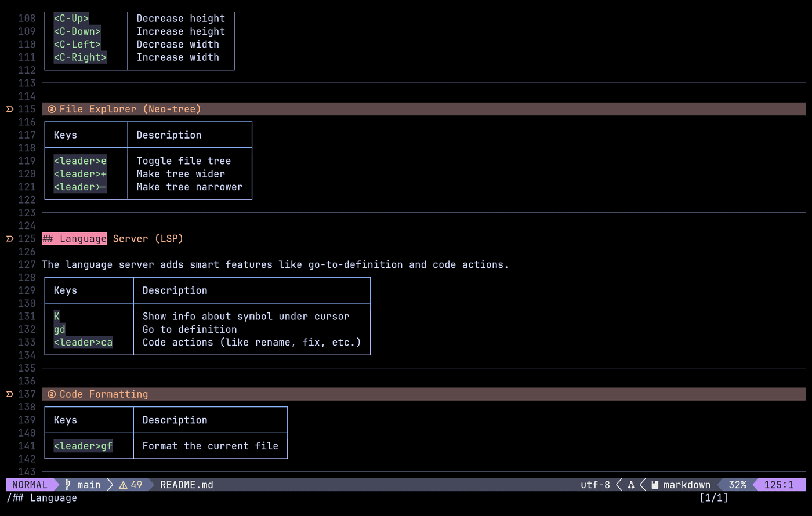

# Markdown

  
On this page

  {: .text-delta }
1. TOC
{:toc}

`render-markdown.nvim` (loaded for `markdown` files) draws Markdown **inside the buffer** while you edit: numbered headings with icons and coloured bars, tables with borders, checkboxes, quotes, code blocks, horizontal rules, links with icons, and callouts. Moving the cursor onto a line shows the raw text again. Diagnostics are off in Markdown buffers (see [LSP](lsp-format.html#diagnostics)); `marksman` provides links and symbols if it is attached.

## Headings and links

- Headings use six numbered icons (`󰎤 󰎧 󰎪 󰎭 󰎱 󰎳`), rendered inline.
- Links are rendered with icons: images, e-mail, hyperlinks and footnotes (superscript), plus **custom icons by site**: web (`^http`), GitHub, GitLab, Stack Overflow, Wikipedia, YouTube, arXiv, WolframAlpha, Overleaf, crates.io, docs.rs, PyPI, npm, DevDocs, MDN, OWASP, PortSwigger and the CVE database.
- Everything else (callouts, checkboxes, bullets, code, inline code, tables, dashes, quotes) uses the plugin's defaults; the config says so in a comment ("rest of your callouts … all unchanged").

## `[[wiki links]]` for my notes

My notes (an Obsidian vault) live in `~/notes`. Obsidian-style links are understood:

- `[[Page]]` and `[[Page|alias]]` are rendered with an icon; the **body** shows the file size and how long ago `~/notes/Page.md` was modified (for example `󱗖 1.2KB | 󰥔 3d ago | Page`), or `󰅖 Missing: Page` when there is no such file.
- **`gf`** (in Markdown buffers only) on a link opens `~/notes/<name>.md` and **creates it if it does not exist**, so a link becomes a new note in one keystroke. The alias part after `|` is ignored.

The helper functions `format_size` and `format_time_ago` (bytes → `B/KB/MB`, seconds → `now`, `Nm ago`, `Nh ago`, `Nd ago`) are at the top of `render-markdown.lua`.

## Lint

`markdownlint` is configured as a none-ls diagnostics source, but diagnostics are **disabled in Markdown buffers** (`lsp-config.lua`), so its messages are never shown while editing a `.md` file. To see them, delete the `FileType markdown` autocommand that calls `vim.diagnostic.enable(false, { bufnr = 0 })`.
