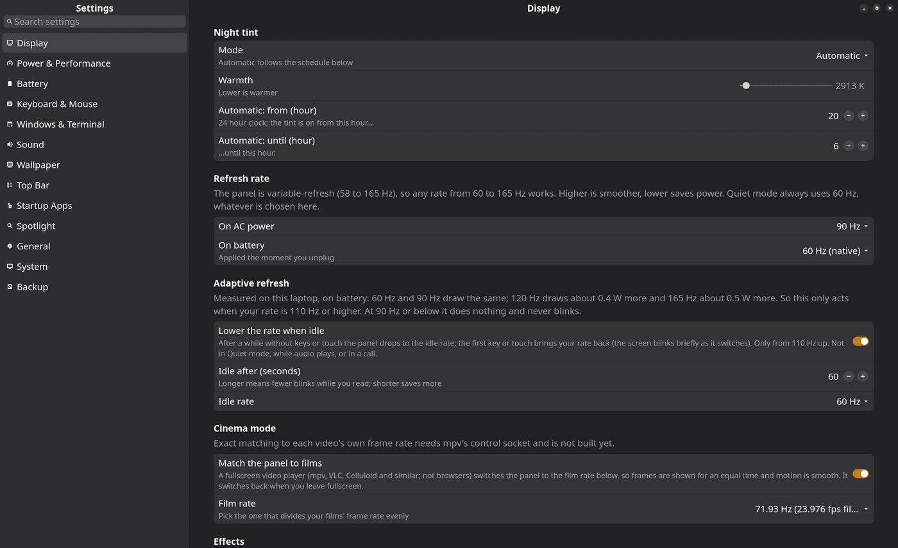

# rog-tune

`rog-tune/` is the folder of scripts I used to tune, trim and set up the ROG Flow X13, and that I keep so I can see exactly *what* I changed and put it back.
It started as "why is this laptop so hot and slow" and grew into the installer for my whole desktop.

## The scripts

| Script | Needs root | What it is |
|---|---|---|
| [`rog-tune.sh`](rog-tune-parts.html) | yes | The **root-side** parts: power saving, kernel and GRUB options, hibernation, the login screen, pacman hooks, services |
| [`rog-lean-session.sh`](lean-session-parts.html) | no | The **user-side** parts: edits my i3, polybar and kitty configs and writes out the helper scripts |
| [Login screen](login-screen.html) | yes (part `greetd`) | The greetd + ReGreet login screen and the helpers the parts install in `/usr/local/lib/rog` |
| [`rog-snappy.sh`](tools.html#rog-snappysh) | yes | Moves the *Balanced* profile to `balance_performance` so the CPU reacts faster |
| [`rog-report.sh`](tools.html#rog-reportsh) | no | What the machine is spending right now (CPU, RAM per app, dGPU state, heat, clocks) |
| [`rog-clean.sh`](tools.html#rog-cleansh) | no | Throws away regenerable caches |
| [`rog-debloat.sh`](tools.html#rog-debloatsh) | for `--apply` | Lists and removes package bloat |
| [`rog-refresh.sh`](tools.html#rog-refreshsh) | no | Switch the refresh rate by hand |
| [`ferdium-lean.sh`](tools.html#ferdium-leansh) | no | Cuts Ferdium's idle cost |
| [`power-compare.sh`](tools.html#power-comparesh) | no | Measures battery draw per mode and per refresh rate |
| [`vaapi-check.sh`](tools.html#vaapi-checksh) | no | Is hardware video decoding available? |
| [`bt-capture.sh`](tools.html#bt-capturesh) | yes (run through systemd) | Records Bluetooth connection events only |

## The house rules

1. **Dry run first.** Nothing changes until I pass `--apply`.
2. **Every change is undoable**, and the undo is part of the script.
3. **Measure before and after.** `rog-report.sh` and `power-compare.sh` exist so I never apply a "tweak" on faith; several parts are marked opt-in because the gain was not measured.
4. **Small and tagged.** Lines these scripts add carry a `rog-tune` marker so they can be found and removed.

## Where the pieces end up

| Source | Result |
|---|---|
| `rog-tune.sh` parts | Files under `/etc`, `/usr/local/lib/rog`, `/boot/grub`, systemd units; the list per part is on [the parts page](rog-tune-parts.html) |
| `rog-lean-session.sh` parts | `~/.config/i3/config`, `polybar/config.ini`, `kitty/kitty.conf`, `~/.bashrc`, and the scripts in `~/.config/scripts` |
| Backups | `/var/backups/rog-tune/<timestamp>/` (root side), `~/.local/share/rog-tune/*.before` (user side), `/var/backups/rog-restore/` (a pacman restore point before every transaction, `restore` part) |

The restore ISO captures the *result* of all this (see [Restore ISO](../iso/)).
