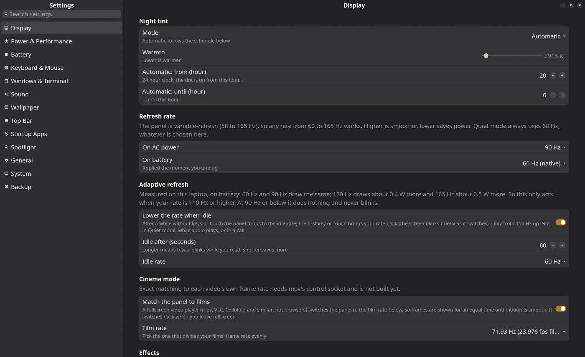

# The Settings app

  
On this page

  {: .text-delta }
1. TOC
{:toc}

`scripts/settings.py` is a GNOME-Settings-style window (**GTK4 + libadwaita**): a category sidebar on the left, grouped rows on the right, and **changes apply at once**, no Apply button. Open it with **Super+,**, or type "settings" in Spotlight.

It is **not** a resident process: it starts on demand (`rog-ui.sh settings` focuses an existing window, otherwise starts one) and leaves nothing in memory when closed. Window class `RogSettings`, default size 1280×800.
`settings.py --backup` opens only the backup folder chooser (Spotlight's "Back up to hp-server…").

Search: type in the box above the sidebar (or `Ctrl+F`) to search *every row title and description*; picking a result jumps to the page and focuses the row. `Esc` clears the search, then closes the window.

## Pages and what they change

| Page | Rows | What happens when I change them |
|---|---|---|
| **Display** | Night tint (mode, warmth 2700-6000 K, from/until hour), Refresh rate (AC, battery: 60-165 Hz), Adaptive refresh (on/off, idle seconds, idle rate), Cinema mode (on/off, film rate), Effects (blur on AC, dim inactive windows) | Writes `settings.env`, then `nightlight.sh reapply` or `power-watch.sh display|refresh`; the effects rows edit `picom-ac.conf` and send picom `SIGUSR1` |
| **Power & Performance** | Performance mode (AC, battery), Low battery (auto-Quiet on/off, at N %), Keeping the screen on (caffeine switch, automatic caffeine), Lock and screen-off minutes (AC, battery), **Fans** (firmware default / quieter / cooler) | `power-watch.sh display|timers|autoquiet`, `caffeine.sh`, `autocaffeine.sh`; fan curves go to `asusctl fan-curve` for each profile |
| **Battery** | Read-only: charge, health (full vs design energy), cycles, power draw, time left/to full, voltage, model | Refreshes every 3 s while open |
| **Keyboard & Mouse** | Tap to click, natural scrolling, ignore touchpad while typing, pointer speed, key repeat delay and rate | `input-apply.sh` |
| **Windows & Terminal** | Focus follows mouse, border thickness, terminal opacity, freeze rotation, tablet mode | Edits `i3/config` with a regex and runs `i3-msg reload`; opacity edits `kitty.conf` and signals kitty; the two switches call `autorotate.sh lock` / `tablet.sh` |
| **Sound** | Output device, volume, mute; input device, volume, mute; **volume per app** | `pactl` (default sink/source, volumes up to 150 %, per-sink-input volume); refreshes every 4 s while open |
| **Wallpaper** | Day and night start hours, change automatically every N minutes, *Change it now* | `wallpaper-timer.sh`, `wallpaper-cycle.sh` |
| **Top Bar** | Which modules show (volume, brightness, battery, memory, CPU, Wi-Fi, microphone, camera), workspace app icons, active-workspace marker (box or line), number weight and size | Rewrites `modules-right`, `font-1` and marker lines in `polybar/config.ini`, then `polybar-msg cmd restart` |
| **Startup Apps** | A switch for every XDG autostart entry | Writes (or removes) a `Hidden=true` stub in `~/.config/autostart`; effective at next login. i3's own `exec` lines are not listed |
| **Spotlight** | Transparency, recents, deep-search folders, info on the clipboard history and shortcuts | `SPOT_OPACITY`, `SPOT_RECENTS`, `~/.config/spotlight/roots` |
| **General** | Theme (light, dark, schedule), accent (amber, wallpaper, custom + colour button), start with the microphone muted, **Export / Import settings**, alarm sound, keep screenshot files | `accent.sh`, `settings.env`; export writes a `.tar.gz` of `settings.env`, `aliases`, `roots`, `sync.list` |
| **System** | Disk free (system, home), memory, uptime, kernel, **SSD health** (from `/var/lib/rog/health.txt`, weekly) | Read-only |
| **Backup** | *Choose folders and back up…* and *Mirror deletions* | Writes `~/.config/spotlight/sync.list`, starts `sync-server.sh` in a floating kitty |

## How a change is applied

`setv(key, value)` re-reads `settings.env`, sets the key and saves (so concurrent writers, like `power-mode.sh`, are not overwritten). Sliders wait 350 ms after you stop moving them before applying. Saving also recomputes `NIGHT_GAMMA` from `NIGHT_K`.
The look (light/dark/accent) is applied with libadwaita's colour scheme (`FORCE_DARK`/`FORCE_LIGHT`) and an `@define-color` accent override.

## Fan curves

The two custom curves (CPU and GPU, eight points each, temperature °C → fan %) are in `FAN_CURVES`: *quiet* stays at 0 % up to 55 °C (CPU) / 60 °C (GPU) and reaches 100 % at 90 °C; *cool* spins early (10 % at 40 °C) and also reaches 100 % at 90 °C. Every curve ends at full speed by 90 °C, and *Firmware default* hands control back to the machine. Applied to the Quiet, Balanced and Performance profiles through `asusctl fan-curve`.

## Export and import

*Export settings* saves `~/.config/rog/settings.env`, `~/.config/spotlight/aliases`, `roots` and `sync.list` into `rog-settings-YYYYMMDD.tar.gz`. *Import settings* only accepts those four names from the archive and then re-applies power, night tint and input. Use it on a fresh install.

## Reference

All 39 keys: [`settings.env` reference](settings-reference.html).
