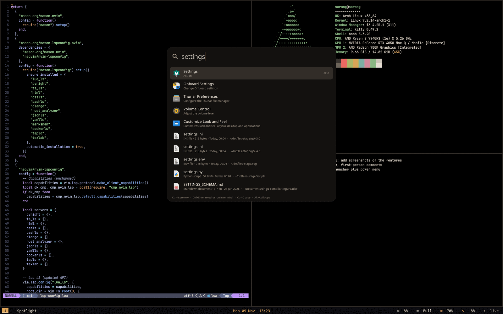

# Spotlight for i3

I missed macOS's Spotlight, so I built one. **One search box** for apps, open windows, files, maths and unit conversion, clipboard history, timers, emoji, bookmarks, a Zotero library, my own aliases and system actions. It is a small resident GTK3 process in Python, so it appears in about 20 ms, searches *while I type*, and closes itself when it loses focus.

The code is one file, `spotlight.py` (about 1500 lines), plus four helpers: `rog-ui.sh` (the client), `alarm.py` (the timer window), `power-menu.py` and `rg-pre.sh` (PDF text for deep search). It lives in its own repo, [`sarang-kernel/spotlight`](https://github.com/sarang-kernel/spotlight), and is also copied into my dotfiles (`apps/spotlight/` and `scripts/`).

## Pages

| Page | What you get |
|---|---|
| [Using it](usage.html) | Every kind of query, with examples |
| [Keys](keys.html) | Every key, in the list view, the home view, the app grid and the preview |
| [Actions](actions.html) | The system actions it offers (lock, performance mode, update …) |
| [Clipboard history](clipboard.html) | How it records and searches what I copy |
| [Timers and reminders](timers.html) | `timer 25m`, `remind 15:30 …` and how alarms work |
| [Deep search](deep-search.html) | Searching *inside* PDFs, notes and code |
| [Aliases and data files](data-files.html) | Everything it reads and writes |
| [Appearance and settings](appearance.html) | Theme, accent, transparency |
| [Power menu and alarm window](power-menu.html) | The two small companion windows |
| [How it works](internals.html) | The resident process, the FIFO, scoring, the window dance |
| [Install](install.html) | Standalone install, dependencies, i3 lines |
| [Troubleshooting](troubleshooting.html) | Things that went wrong |
