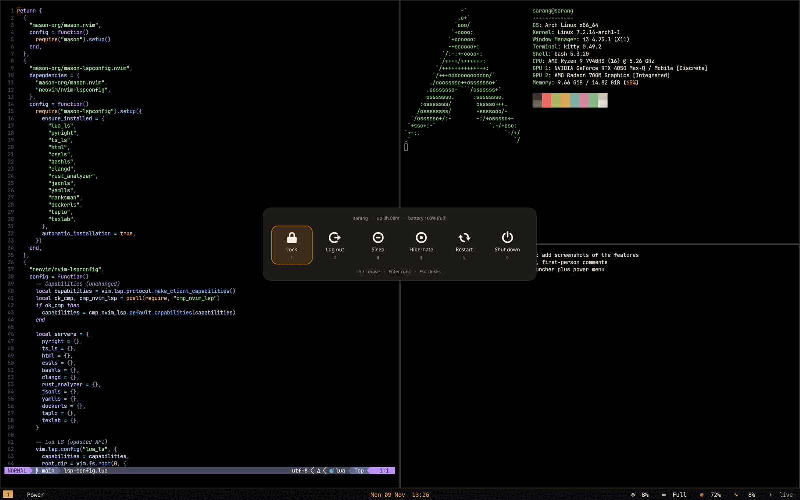

# Power menu and alarm window

Two small windows that share Spotlight's look.

## Power menu (`Super+Esc`)

`power-menu.py` shows six tiles in one row: **Lock, Log out, Sleep, Hibernate, Restart, Shut down**.

| Key | |
|---|---|
| `h`, `l`, `Left`, `Right`, `Tab`, `Shift+Tab` | Move |
| `1` … `6` | Pick (and run) |
| `Enter` or `Space` | Run the selected tile |
| `Esc` or `q` | Close |
| `Super+Esc` again | Closes it (it finds another copy of itself and ends it) |

**Lock** and **Sleep** run at once. **Log out, Hibernate, Restart and Shut down need a second Enter**: the first press turns the tile solid and the line underneath says what will happen (for example *Press Enter again to hibernate (saves to disk, powers off)*). Moving away disarms it, so a slip never ends the session.
The first line shows host name, uptime and battery (`battery 63% (discharging)`). Hibernate is hidden when the kernel command line has no `resume=`.
The commands are `lock.sh`, `i3-msg exit`, `systemctl suspend`, `systemctl hibernate`, `systemctl reboot` and `systemctl poweroff`. The window class is `RogPower` (i3 rule: floating, no border, centred), and the colours follow `APPEARANCE` and the accent.

## Alarm window

The alarm card that a timer or reminder raises is described on [Timers and reminders](timers.html#the-alarm-window).
